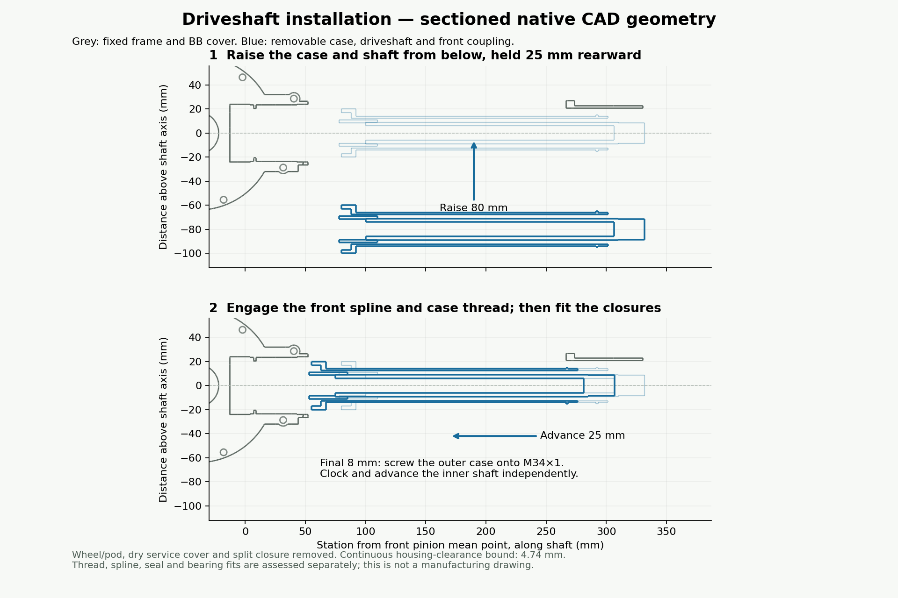

# Closed housing and driveshaft assembly

The previous layout did not provide a workable documented installation route: the Ø47 pinion bearings cannot pass through the Ø25 shaft-case bore, and the projecting pinion spline prevents simply lifting the shaft into a fixed neck. Closing the exposed nose alone would leave that problem unresolved.

The revised model closes the exposed front pinion-housing nose with a nominal 3 mm wall and makes the seal carrier, shaft-case tube and rear chamber closure removable. The nose opens internally into the BB oil cavity. The drive cap travels with its pinion stack; it cannot be pulled independently across the bearing seats.



## Installation order

1. **Load the front pinion into the detached drive cap on the bench.** Fit the matched bearings, 6 mm spacers, shim and retaining clip onto the pinion journal, supporting the inner races. With the seal carrier absent, insert the stack forward through the rear of the cap. The pinion head fits inside a checked Ø36 envelope and passes the integral Ø41 stop. The first Ø47 bearing stops at station 9 mm. A fixture supports the stack while handling the cap.
2. **Fit the drive cap and pinion together.** Install the main-case drivetrain first, including its sun support and bevel gear. Offer the cap along the crank axis and rotate the unloaded gears to engage the teeth. Dowel and clamp the matched cap. This step is a dimensional assembly proposal; the swept check below does not prove gear-tooth engagement or tool access.
3. **Fit the rear seal carrier.** Protect the seal lip over the spline, install the M48×1 carrier, set bearing preload with controlled spacers/shims and lock it with the modeled M3 dog-point screw. Match-drill the blind locking pocket after setting the stack. Finish the split seats and threads with the cap clamped. The carrier retains the second bearing and carries the 17×28×7 rotary seal.
4. **Fit the removable shaft case and shaft.** On the bench, slide the shaft and Ø22 female coupling through the Ø25 case bore. Remove the rear wheel/pod, lower dry-chamber service cover and two-piece closure. Hold the assembly 25 mm rearward of its final position, then raise it from 80 mm below onto the shaft axis. This starts with 3 mm between the female coupling and pinion tip. Advance 25 mm, clocking the shaft independently onto the spline. During the final 8 mm, screw the outer case onto the carrier's M34×1 spigot while advancing the inner shaft independently.
5. **Close and retain the case.** Fit the whole O-ring over the rear Ø32 shoulder using a protective cone; the temporary stretch is approximately 14%, subject to the seal supplier's installation limit. Install the lower service cover using four transverse M4 positions. Fit the two-piece closure with four axial M4 positions. Its groove captures the tube shoulder with nominal 0.2 mm axial allowance; 30 mm flats prevent rotation. Match/time the M34 thread or use controlled shoulder shims so the flats align with the fitting fully seated. Do not loosen a seated thread to align the flats.
6. **Install the rear module and coupling.** Register the wheel/pod, seal its dry-chamber butt joint and assemble the split shaft coupling. Set the rotating shaft's axial float to the proposed 0.3–0.5 mm independently of the outer case retention. Verify unloaded rotation and bearing settings before load testing.

Disassembly reverses this order. Remove the wheel/pod, closure and service cover, unscrew and withdraw the case/shaft assembly, then remove the seal carrier. The drive cap must come out with the pinion stack. Final fixtures, wrench features, screw heads and torque specifications belong in the manufacturing drawings.

## Closure and sealing

The exposed nose is solid; service access is from the rear and through the main cap. Seal the interrupted drive-cap flange with oil-compatible anaerobic flange sealant. Seal the M48 carrier shoulder/thread and M34 case fitting. The dry chamber uses a 2.5 mm section O-ring around the Ø28 tube, in a 3.4 mm wide × 2.1 mm deep radial gland, plus removable sealant on the split closure, service-cover and pod mating faces. The existing rotary seal separates gearbox oil from the dry tube. These are modeled envelopes and specified sealing interfaces; tolerance-stack squeeze and water/oil leakage still require validation.

## Evidence and limits

The [continuous sweep results](assembly-clearance.json) establish both installation movements against the fixed frame and installed drive cap:

| Movement | Conservative lower clearance | Target |
| --- | ---: | ---: |
| Raise from below, held 25 mm rearward | 4.74 mm | 0.5 mm |
| Advance 25 mm, including outer-case rotation | 4.74 mm | 0.5 mm |

The checker first establishes that every triangle of the three moving native STL meshes lies in one of the enclosing convex cylinders. It then bounds the continuous swept cylinders against every triangle of the two fixed meshes using a 1-Lipschitz distance field. This checks the entire motions, rather than a few sampled poses. Envelopes are inflated by 0.03 mm; the triangle-bound tolerance is 0.20 mm with a separate 0.02 mm mesh allowance. Results record the mesh hashes and solved datums. These allowances do not constitute a manufacturing tolerance certification.

The rear wheel/pod, lower service cover and split closure are absent during this check. Intended M34 thread contact, spline engagement, seal/bearing fits and gear engagement are excluded from the sweep. Nominal dimensions provide 1.5 mm radial clearance from the front female coupling to the carrier bore and 1 mm axial clearance to the seal. Thread profiles, loaded deflection, detailed bearing fits, gear contact and tooling need separate validation. The result establishes a nominal shaft-installation corridor, not complete bicycle assembly or fabrication readiness.

The audit also found a real pinion/bearing collision in the previous revision: the tooth shell reaches station 7.40 mm, while the first bearing started at 5 mm. The [before check](validation/pinion-bearing-before.txt), run against commit `8357667`, reports −2.299 mm signed spacing. The bearing now starts at 9 mm and ends at 23 mm; the second remains at 29–43 mm. The [current solid checks](validation/drive-release.txt) establish at least 1.596 mm pinion-to-inner-ring clearance and contain the pinion head within the Ø36 loading envelope. All 22 selected solid claims hold. The head-envelope check is not a sweep of the entire cap/pinion installation.

The shorter 20 mm bearing-center span raises the preliminary proximal radial reaction from about 2.52 kN to 3.02 kN. The radial-only static screen becomes 1.325 at twice that reaction; combined-load sizing, angular-contact pressure centers, preload and fatigue life remain open. Gear teeth and ratios are unchanged. The existing inconclusive bevel rolling result is not superseded by these housing checks.

## Reproduce

```sh
SOLVENTC=/path/to/solventc SKIP_ROLLING=1 scripts/export.sh /absolute/output
```

This reruns the dimensional, selected solid, wheel-envelope and shaft-path checks and generates the assembly diagram. Omitting `SKIP_ROLLING=1` also runs the long tooth checks. The focused sweep can be rerun using the exported `frame_main.stl`, `drive_cap.stl`, `shaft_case.stl`, `shaft.stl`, `front_coupler.stl` and solved `assembly-datums.json`:

```sh
python engineering/check_shaft_assembly.py \
  /absolute/output/stl/exact/frame_main.stl \
  /absolute/output/stl/exact/drive_cap.stl \
  /absolute/output/reports/assembly-datums.json \
  --moving /absolute/output/stl/exact/shaft_case.stl \
           /absolute/output/stl/exact/shaft.stl \
           /absolute/output/stl/exact/front_coupler.stl \
  --out engineering/assembly-clearance.json
```
